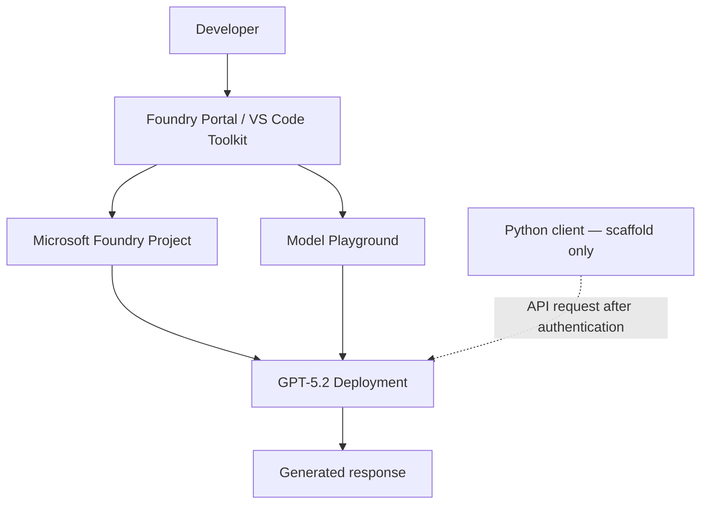

# Microsoft Foundry — Module 1 | AI Development Foundations

**A documented, hands-on Azure AI learning lab** demonstrating how to provision a Microsoft Foundry project, deploy and test a language model, and explore Python integration through Visual Studio Code.

> **Portfolio status:** Module 1 portal and VS Code playground exercises completed. Python Agent Framework integration code generated; successful local execution has **not** been verified. This repository is a learning lab, not a production AI application.

## What I built and explored

- Created a **Microsoft Foundry resource and project** in Azure, organizing model and developer assets.
- Deployed **GPT-5.2** with a **Global Standard** deployment for model inference.
- Tested model instructions and prompts in the **Foundry Portal playground**.
- Installed **Foundry Toolkit for VS Code**, connected the Azure project, and tested model behavior through the editor's playground.
- Generated a **Python Agent Framework integration scaffold** with a model endpoint and Microsoft Entra ID authentication pattern.
- Documented the difference between resources, projects, models, deployments, agents, tools, APIs, endpoints, and SDKs.

## Architecture — what the lab demonstrated



The model runs on Azure; the portal and VS Code are ways to configure and interact with it. An application can later access the deployment using an authenticated SDK/API request.

## Repository contents

```text
.
├── README.md
├── notes/
│   ├── module-1-study-notes.md
│   └── lab-journal.md
├── examples/
│   ├── prompt_design.py
│   └── foundry_agent_scaffold.py
├── tests/
│   └── test_prompt_design.py
└── screenshots/
    └── README.md
```

## Try the local, no-cloud exercise

The prompt-design example builds structured system and user messages and requires **no Azure credentials, deployments, or billable AI requests**.

```bash
python examples/prompt_design.py
python -m unittest discover -s tests -v
```

The `foundry_agent_scaffold.py` example illustrates code generated from the toolkit. It is **not a verified working deployment**; configuration, a compatible package set, and Azure identity access are required before running it. The endpoint is read from an environment variable rather than stored in this repository.

## What I learned

1. **Portal vs. SDK:** Use the portal for visual setup and model experiments; use SDKs for code-driven integration and automation.
2. **Resource vs. project:** A Foundry resource provides shared Azure capabilities, while projects organize individual AI solutions.
3. **Model vs. agent:** A deployed model generates responses; an agent adds instructions and potentially tools/workflows around a model.
4. **Deployment vs. inference:** Deployment makes a model callable. Inference sends a prompt and receives model output.
5. **Endpoint + identity:** Applications need a service endpoint, a deployment name, and approved authentication to call the model.

Read the [full Module 1 notes](notes/module-1-study-notes.md) and [lab journal](notes/lab-journal.md).

## Next milestones

- [ ] Verify the Python API integration end-to-end with a successful model response.
- [ ] Add a small, versioned prompt evaluation dataset with expected behaviors.
- [ ] Build a document-grounded Q&A application and assess answer correctness and citation quality.
- [ ] Document latency, costs, and error handling after real measurements.

## Security, privacy, and limitations

- This is a **learning portfolio**, not a deployed clinical product or a completed ML engineering system.
- Do not commit API keys, authentication tokens, `.env` files, protected patient information, or employer documents.
- The examples use fictional questions and general technical concepts, not personal health records.
- Azure model usage can incur charges; remove unneeded deployments/resources after labs.
- Product interfaces, model availability, and SDK versions can change. Consult current Microsoft documentation.

## References

- [Microsoft Foundry portal](https://ai.azure.com/)
- [Microsoft Learn — Develop generative AI apps](https://learn.microsoft.com/en-us/training/paths/develop-generative-ai-apps/)
- [Microsoft Foundry Toolkit in VS Code](https://learn.microsoft.com/en-us/azure/foundry/how-to/develop/get-started-projects-vs-code)
- [GitHub documentation — create a repository](https://docs.github.com/en/repositories/creating-and-managing-repositories/creating-a-new-repository)
