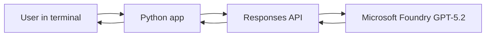

# Module 3 — Python chatbot with Microsoft Foundry

A portfolio-ready progression of Python exercises using the **Responses API** and a **GPT-5.2 deployment** in Microsoft Foundry.

## Exercises

| File | Purpose |
| --- | --- |
| `run_model.py` | Sends a sample question to the deployed AI model and prints the response. |
| `interactive_chat.py` | Supports multiple questions and follow-up context using `previous_response_id`. |
| `chatbot_app.py` | Separates authentication, model requests, and chat interactions into functions. |
| `tests/test_chatbot_app.py` | Tests request construction offline with mock client objects. |

## Architecture



## Run the project

Use Python 3.10 or later. From the GitHub repository root:

```bash
python -m pip install -r module-3-chatbot/requirements.txt
python module-3-chatbot/run_model.py
python module-3-chatbot/interactive_chat.py
python module-3-chatbot/chatbot_app.py
```

Type `exit` to end an interactive session.

Authentication uses **Microsoft Entra ID** via `DefaultAzureCredential`. Your environment needs a valid Azure sign-in and permission to access the deployment (for example, an appropriate Azure CLI login or configured managed identity). Never publish API keys or bearer tokens.

The included code defaults to the resource and deployment used for these exercises. To use a different resource, override configuration in your terminal:

```bash
export AZURE_OPENAI_BASE_URL="https://YOUR-RESOURCE.openai.azure.com/openai/v1/"
export AZURE_OPENAI_DEPLOYMENT="gpt-5.2"
```

In Windows PowerShell, set these via `$env:AZURE_OPENAI_BASE_URL = "..."` and `$env:AZURE_OPENAI_DEPLOYMENT = "..."` instead. The endpoint must be the **Azure OpenAI v1 endpoint**, ending in `/openai/v1/`.

### Offline tests

```bash
python -m unittest discover -s module-3-chatbot/tests -v
```

## Status and limitations

- A direct Python-to-GPT-5.2 Responses API request was observed working in VS Code for the Web.
- The chat exercises were developed during Module 3; the independently published versions have not been cloud-tested again.
- Chat context uses the Responses API's prior response ID, not a permanent local chat history database.
- These examples are **clean portfolio adaptations**, not an automatic or byte-for-byte copy of the entire live Azure Workspace.
- No patient records, employer documents, API keys, or credentials should be included.

## Sources

- [Microsoft Foundry OpenAI v1 API](https://learn.microsoft.com/en-us/azure/foundry/openai/api-version-lifecycle)
- [Foundry SDK and endpoints](https://learn.microsoft.com/en-us/azure/foundry/how-to/develop/sdk-overview)
